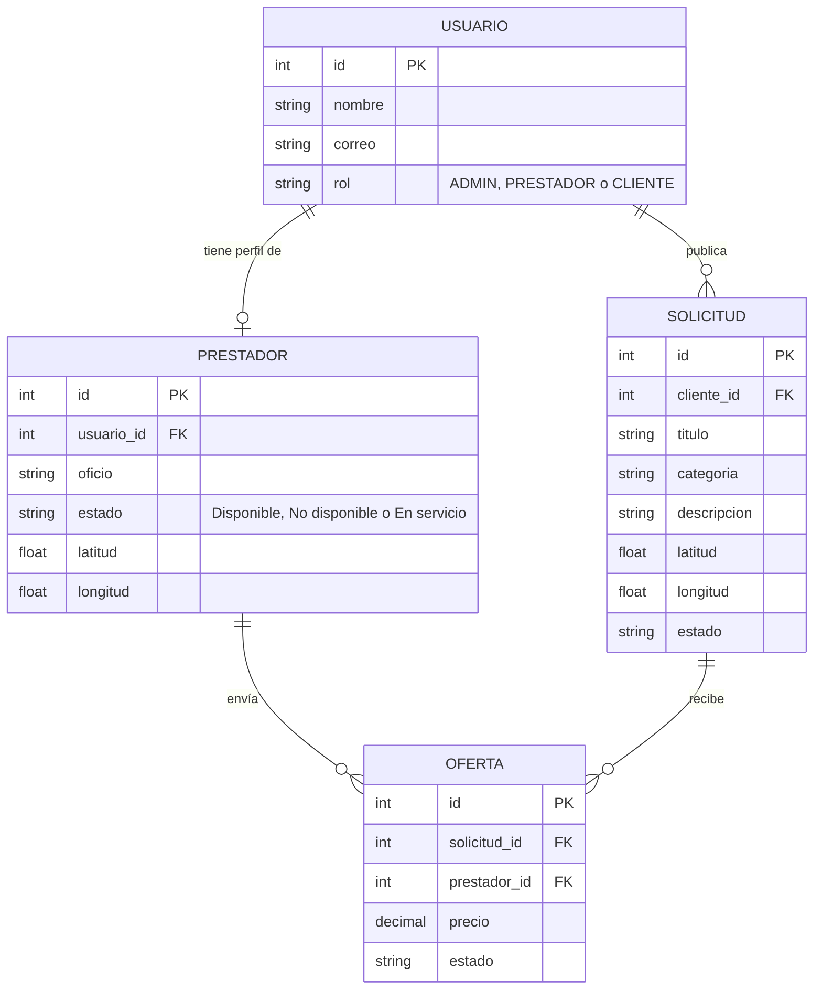
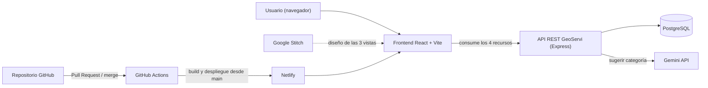

# web-design-geoservi-app

Esqueleto de la arquitectura de **GeoServi-App**, una plataforma que conecta a personas que necesitan un servicio doméstico (plomería, electricidad, etc.) con prestadores que están cerca de ellas, usando geolocalización.

Este repositorio es la actividad de diseño de arquitectura web: tiene la planificación, los diagramas y el proyecto base funcionando, sin la lógica de negocio completa.

## Integrantes

- Diego Andrés Bermúdez
- Luis Miguel Montalvo Álvarez

## Elevator pitch

Cuando se daña algo en la casa, encontrar a alguien de confianza y cercano toma tiempo. GeoServi-App deja que el cliente publique su solicitud con su ubicación y que los prestadores disponibles cerca le envíen ofertas. Así el cliente compara y elige, y el prestador consigue trabajo sin intermediarios.

## Stack

| Parte | Tecnología |
|---|---|
| Framework | React con Vite |
| Lenguaje | JavaScript |
| Rutas | React Router |
| API | API REST propia (Express), consumida por el frontend |
| Base de datos | PostgreSQL |

## Herramientas TIC integradas

1. **Google Stitch**: se usó para diseñar y prototipar las 3 vistas antes de programarlas. Nos ahorró tiempo porque pudimos ver el flujo completo y ajustarlo sin escribir código. Enlace en la sección de diseño.
2. **Gemini API**: se usa para sugerir la categoría de una solicitud a partir de lo que escribe el cliente (por ejemplo, "se me dañó el tomacorriente" → Electricidad). La llamada a Gemini la hace el backend para que la clave no quede expuesta en el navegador.
3. **GitHub Actions**: automatiza el trabajo del equipo. En cada Pull Request compila el proyecto para detectar errores antes del merge, y cuando se hace merge a `main` despliega la app en Netlify.

## Recursos (entidades) de la API

| Recurso | Ruta | Para qué sirve |
|---|---|---|
| Usuarios | `/usuarios` | Cuentas con rol ADMIN, PRESTADOR o CLIENTE |
| Prestadores | `/prestadores` | Perfil del prestador: oficio, estado y ubicación |
| Solicitudes | `/solicitudes` | Lo que publica el cliente que necesita un servicio |
| Ofertas | `/solicitudes/:id/ofertas` | Lo que responde cada prestador a una solicitud |

## Diagrama ER



## Diagrama de arquitectura



## Diseño de la interfaz (Google Stitch)

- Enlace al diseño en Stitch: **[pegar aquí el enlace]**

Las 3 vistas y los datos que usa cada una:

| Vista | Ruta | Endpoints que la alimentan |
|---|---|---|
| Dashboard: lista de solicitudes cercanas | `/` | `GET /solicitudes` |
| Detalle de una solicitud con sus ofertas | `/solicitud/:id` | `GET /solicitudes/:id`, `GET /solicitudes/:id/ofertas` |
| Configuración e integración con herramientas TIC | `/configuracion` | `POST /ia/sugerir-categoria` (Gemini) |

Flujo de usuario: el cliente entra al Dashboard, abre una solicitud para ver el detalle y las ofertas, y desde Configuración puede probar la sugerencia de categoría con Gemini.

Capturas del diseño:


## Proyecto funcionando


## Cómo correrlo

```bash
git clone https://github.com/[usuario]/web-design-geoservi-app.git
cd web-design-geoservi-app
npm install
cp .env.example .env
npm run dev
```

Si `VITE_API_URL` está vacía en el `.env`, la app usa datos de ejemplo y se puede ver funcionando sin backend. La clave de Gemini va solo en el backend y nunca se sube al repositorio.

## Estructura de carpetas

```
web-design-geoservi-app/
├── .github/
│   ├── workflows/ci.yml          # GitHub Actions: build y despliegue
│   └── pull_request_template.md
├── docs/capturas/                # Capturas de Stitch y del proyecto
├── src/
│   ├── components/               # Navbar
│   ├── pages/                    # Dashboard, Detalle, Configuracion
│   ├── services/                 # api.js, geminiService.js, mockData.js
│   ├── App.jsx
│   ├── main.jsx
│   └── styles.css
├── .env.example
├── .gitignore
├── index.html
├── package.json
└── vite.config.js
```

## Flujo de trabajo en GitHub (GitHub Flow)

La rama `main` siempre debe quedar funcionando. Cada funcionalidad se trabaja en su propia rama y se une con un Pull Request que revisa otro integrante.

Ramas que usamos:

- `feature/estructura-base`
- `feature/vistas`
- `feature/servicios-api`
- `feature/integracion-gemini`
- `feature/github-actions`
- `docs/readme-final`

## Video de presentación

- Enlace al video (máximo 5 minutos): **[pegar aquí el enlace]**
